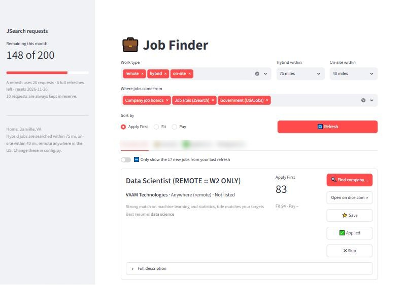

# Job Finder

Companies use software to filter candidates, so I built software to filter companies.

Job Finder is a personal job search tool that runs on your own computer for free. It pulls listings from job sites, tech company career pages and USAJobs, keeps the ones that fit your location rules, filters out scams and junk, then scores every job against your resume and ranks them. **It never applies for you.** You read the posting and apply yourself; it just helps you spend your time on jobs you actually fit.

I built it during my own job search as a new data science grad.



## What it does

- **Pulls jobs from three kinds of sources**
  - **JSearch** (free tier on RapidAPI): Indeed, LinkedIn, Glassdoor and other job sites, via Google for Jobs.
  - **Company job boards**: about 50 tech companies (OpenAI, Anthropic, Airbnb, Stripe, Spotify, Pinterest, Reddit, Duolingo, Databricks and more) through the free public Greenhouse, Lever and Ashby feeds. No key and no limit, full descriptions, and every link goes straight to the company's own posting.
  - **USAJobs**: federal government jobs (free key).
- **Applies your location rules**: remote anywhere in the US, hybrid within one radius, on-site within a shorter one.
- **Filters out junk**: spam and repost sites, fake "work from home" listings, pay-to-train "placement programs" posing as jobs, AI-training gig shops, and hourly-paid roles (optional).
- **Scores every job against your resume** with a 0-100 fit score, a pay score and a combined **Apply First** rank, plus a plain-language reason like *"Strong match on Python, SQL and statistics, title matches your targets, entry-level"*.
- **Supports more than one resume**: each job is scored against all of them, and it tells you which one to send.
- **Finds the real posting**: an "Apply on company site" button when the company's own link is known, or a one-click search for it when it isn't.
- **Tracks your search**: save, mark applied, or skip jobs. Skipped jobs never come back, and each refresh shows what's new.
- **Protects your free API budget**: it tracks JSearch requests, keeps a reserve, and stops before going over.

## How the scoring works

1. **Meaning, not just keywords.** A free sentence-embedding model from Hugging Face ([all-MiniLM-L6-v2](https://huggingface.co/sentence-transformers/all-MiniLM-L6-v2)) runs locally and compares each job to your whole resume and to separate pieces of your background: skills, degree and coursework, dissertation or main project, and leadership. Long descriptions are split into overlapping chunks so nothing gets cut off.
2. **Rules based on your profile adjust the score:**

| Rule | Points |
|------|--------|
| Title matches one of your target titles | +8 |
| Entry-level, junior, associate or new-grad | +8 |
| Mentions Python, SQL, machine learning, statistics | +2 each |
| Senior, lead, principal, manager title | −15, and fit can't go above 45 |
| Mid-level, "II" or "Experienced" title | −8 |
| Internship | −10 |
| Asks for 5+ years of experience | −20, and fit can't go above 45 |
| Asks for 3-4 years of experience | −10, and fit can't go above 60 |
| Asks for 2 years of experience | −4 |
| Starting pay of $200k+ (a sign of a senior role when years aren't stated) | −10, and fit can't go above 55 |
| Short listing (just a summary, so experience can't be checked) | −10 |
| Asks for a PhD (with no master's alternative) | −15 |
| Requires a security clearance | −15 |

3. **TF-IDF word matching** is a small tie-breaker, and the backup if the AI model can't load.
4. **Pay score** compares a job's salary to the typical salary for the same title (50 = typical). **Apply First** = 75% fit + 25% pay, and jobs with no salary listed count as typical so they aren't punished.

The rules are at the top of `scoring.py`, and they're meant to be edited for your own profile.

## Install

You need **Python 3.11, 3.12 or 3.13** ([download 3.13](https://www.python.org/downloads/)). Newer versions don't work yet because PyTorch, used by the AI model, doesn't support them.

1. **Download this project:** click the green **Code** button above, then **Download ZIP**, and unzip it somewhere like your Documents folder.
2. **Install:**
   - **Windows:** double-click **`install.bat`**. If it says so at the end, also install Microsoft's free [Visual C++ runtime](https://aka.ms/vs/17/release/vc_redist.x64.exe).
   - **Mac/Linux:** open a terminal in the folder and run `bash install.sh`.

   It takes about 5–10 minutes (it downloads about 1 GB, mostly PyTorch).
3. **Start it:**
   - **Windows:** double-click **`open-app.bat`**.
   - **Mac/Linux:** run `./open-app.sh`.

   Your browser opens to the app at http://localhost:8501. Keep the terminal window open while you use it.
4. **Fill in the setup screen** the first time it opens: your resume, your city, how far you'll travel, the job titles you want, and optional API keys. Then hit **🔄 Refresh**. The first search takes a few extra minutes while the AI model (~90 MB) downloads.

You can change any of it later from **⚙️ Settings** in the sidebar.

### Free API keys (optional)

Without keys you still get jobs from about 50 tech company career pages. Adding keys gets you much more:

- **JSearch** (Indeed, LinkedIn, Glassdoor and more): subscribe to the free "Basic" plan at https://rapidapi.com/letscrape-6bRBa3QguO5/api/jsearch and copy your `X-RapidAPI-Key`. It allows 200 requests a month, and the app keeps count for you.
- **USAJobs** (federal jobs): request a free key at https://developer.usajobs.gov/apirequest/.

Paste them into the setup screen. They're saved in `keys/.env` on your computer.

## Using it

On Windows, double-click:

- **`open-app.bat`**: opens the app in your browser (http://localhost:8501). Keep the black window open while you use it.
- **`find-jobs.bat`**: searches for new jobs and ranks them, without the app.
- **`rank-jobs.bat`**: re-scores the jobs you already have (no API requests), e.g. after changing your resume or settings.
- **`check-usage.bat`**: shows how many JSearch requests you have left this month.

Or from a terminal in the project folder:

```
.venv\Scripts\python.exe -m streamlit run app.py   # the app
.venv\Scripts\python.exe fetch_jobs.py             # find new jobs
.venv\Scripts\python.exe score_jobs.py             # score and rank (or: score_jobs.py fit / pay)
.venv\Scripts\python.exe resume_reader.py          # check how your resumes were read
.venv\Scripts\python.exe usage.py                  # JSearch request budget
```

### In the app

- **Filters at the top**: work type, distance for hybrid and on-site jobs, which sources to show, and sort by Apply First, Fit or Pay.
- **🔄 Refresh** searches every source and scores the new jobs (about 20 JSearch requests). New jobs are tagged 🆕.
- **Each job** shows its scores, the reason, the best resume to send, salary (or "Not listed"), and the full description with every site it's posted on.
- **⭐ Save, ✅ Applied, ✖ Skip** sort jobs into tabs.

## Configuration

Your personal settings (city, distances, job titles, extra background) are set in the app and saved in `my_settings.json`. City distances are worked out with OpenStreetMap's free [Nominatim](https://nominatim.org/) service and cached in `data/geocache.json`, so it works anywhere in the US.

For more control, `config.py` has the shared settings:

| Setting | What it does |
|---------|--------------|
| `COMPANY_BOARDS` | Companies to check. Add one by finding its careers page: `job-boards.greenhouse.io/NAME`, `jobs.lever.co/NAME` or `jobs.ashbyhq.com/NAME` |
| `BLOCKED_SITES`, `BLOCKED_COMPANIES`, `BLOCKED_TITLE_WORDS` | The blocklist |
| `EXCLUDE_HOURLY_PAY`, `EXCLUDE_PLACEMENT_PROGRAMS` | Turn those filters on or off |
| `BOARDS_SKIP_SENIOR` | Skip Senior/Staff/Principal roles from company boards |
| `PIECE_WEIGHTS`, `FIT_WEIGHT` | How the scores are weighted |
| `JSEARCH_MONTHLY_LIMIT`, `JSEARCH_RESERVE` | Request budget |

Microsoft, Apple, Google, Amazon and Meta use their own hiring systems with no free public feed, so they can't be added as company boards. JSearch still finds some of their jobs, and their careers sites offer free email alerts.

## Project structure

| File | What it does |
|------|--------------|
| `app.py` | The Streamlit web app |
| `settings_page.py` | The setup / settings screen |
| `config.py` | Shared settings, and loads your personal ones from `my_settings.json` |
| `geocode.py` | Looks up any US city's location (OpenStreetMap), with a cache |
| `install.bat`, `install.sh` | One-step installers for Windows and Mac/Linux |
| `fetch_jobs.py` | Pulls jobs from every source, filters and saves them |
| `score_jobs.py` | Scores every job and prints them ranked |
| `scoring.py` | How fit, pay and Apply First are worked out |
| `resume_reader.py` | Reads your resumes and splits them into background pieces |
| `blocklist.py` | Drops spam sites, unwanted companies, placement programs and hourly pay |
| `apply_links.py` | Picks the company's own posting out of the sites a job is listed on |
| `find_company_links.py` | Looks up company links for jobs you already have (1 JSearch request each) |
| `location.py` | Distance, remote/hybrid/on-site detection, location rules |
| `usage.py` | Tracks API requests so you don't run out |
| `db.py` | The local SQLite database |
| `sources/` | One file per job source: `jsearch.py`, `usajobs.py`, `company_boards.py` |

Your settings (`my_settings.json`), keys (`keys/.env`), resumes (`resume/`) and job database (`data/`) stay on your computer and are excluded from Git.

## Built with

Python · sentence-transformers (Hugging Face) · scikit-learn · SQLite · Streamlit

## License

[MIT](LICENSE)
